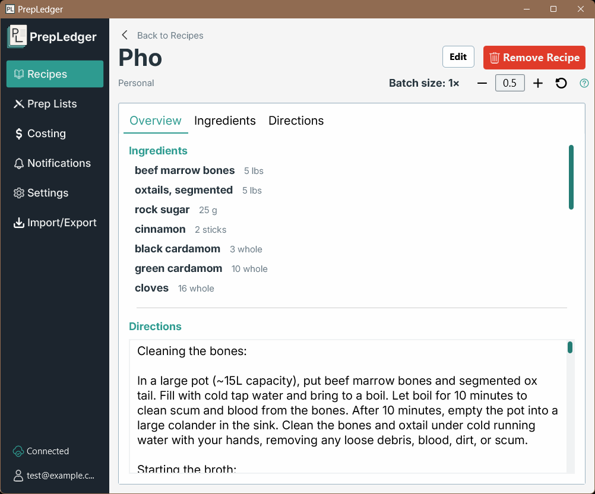

# PrepLedger Recipe manager

- Adding a new recipe

# What this app is for

At its core, PrepLedger is a simple recipe manager that allows multiple users to access the same database of recipes. Administrators can use the desktop application to manage a master list of recipes, while users on the (upcoming) mobile application who are connected to the same restaurant database can view them.

# Usage

## Installation (Win 10, 11)

PrepLedger will be available via a `.exe` installer. Future versions will support MacOS and Linux.

The `.exe` installer will install PrepLedger along with all dependencies to a default directory and configure required environment variables.

## Getting Started

Begin by creating an account through the desktop application. Recipes are tied to your account, and each account has a database tied to it. 

Once logged in, the list of existing recipes will be displayed on the left, while information on any selected recipe will be displayed on the right. 

Buttons for creating, removing, and editing recipes are situated on the bottom left of the screen. 

Recipes can be filtered by name or by their associated tags in the "filter" section above the recipe selection list. Recipes may also be scaled with the scale spinner above the recipe description section.

### Adding New Recipes

To add a new recipe, use the Sidebar on the left-hand side of the screen to navigate to "Recipes", and then click the "+ Add Recipe" button in the top-right hand of the screen. You will be taken to the "New Recipe" page.

Give the recipe a title, a list of ingredients, and some instructions. You may opt to include tags for your recipes, but they are optional. Helpful uses for tags allow you and your staff to search for recipes by the section(s) that they are associated with; for example: *Garde Manger, Saucier, Entremetier.*

There are few restrictions for how you can add ingredients, but one such restriction is: **if the ingredient has an amount, it must have a unit**. For example:

| Ingredient Name | Amount | Unit | Notes | Ingredient Valid? |
| :-- | :-- | :-- | :-- | :-- |
| Salt | - | - | - | Yes |
| Garlic | 1 | clove | crushed | Yes |
| Vinegar | 1/2 | - | - | No (has amount, but no unit) |
| Peppercorns | - | - | A handful | Yes |
| - | 1 | tbsp | - | No (name missing) |

From the examples above, the only requirement for an ingredient to be valid is a **name** for the ingredient, and, if the ingredient has an amount, then how much of the amount must be specified.

# Features

## Always-Online Database

Your recipes are stored in a database on the cloud. To access your current recipes, an internet connection is required.

## Automatic Backups (coming soon)

PrepLedger will automatically backup the latest snapshot of your recipes to JSON upon exiting. In the event that you cannot connect to the internet, the most recent backup will be loaded.

## Recipe Scaling

Recipes can be scaled up incrementally for batching out recipes. This feature is available from the "Recipe View" screen. From the "Recipes" screen, click on any recipe in the list to navigate to the "Recipe View" screen. The scaling options are on the top-right. You may scale a recipe up ( **+** ) or down ( **-** ) by the **scale factor** in the number field. By default, recipes will scale up or down by 0.5 times. The reset button will reset all amounts.

## Import/Export

Recipes can be manually exported to and imported from JSON. You can export your entire recipe collection, or just a selection of recipes. This is helpful for migrating recipes from one PrepLedger installation to another, or sharing recipes. 

## Languages

PrepLedger will be available in English and French at launch. Additional languages may be added in the future.

## Themes

PrepLedger introduced themes in beta v0.1.2 and the current theme can be changed by navigating to the **Settings** page via the Sidebar. Some people may find that the default *light* theme may cause eye strain; for this reason, a *dark* theme was added. More themes may be added in future releases.

# Upcoming Features

## Costing

Input your cost of raw product and PrepLedger will calculate the total cost of recipes based on how much of each ingredient they use.

## Prep Lists

Keep track of your employees prep lists by section; monitor the status of the work day based on which tasks have been completed against which tasks still need to be completed.

## Mobile Application

The mobile application will allow staff who are invited to your restaurant group to view recipes. Additionally, administrators can grant priveleges to certain users who may then propose changes to recipes, or propose entirely new recipes. These will appear in your **Notifications** where you can review, approve, deny, or modify the incoming changes.

A single PrepLedger Administrator account will not only have its associated recipes, but also a list of staff who have these permissions.

An incoming recipe creation/edit request from a staff will take the form of a notification in the Administrator's notification center. These requests can be quickly viewed and accepted or rejected with a single click. Upon accepting a change, the database will update itself to reflect the changes.

## User management

The Administrator will have the ability to send invites to new staff who will then enter their information and register for an account. Staff who no longer work at the establishment can have their permissions revoked.

## Accessibility

Themes for individuals with various colour-blindness. Planned accessibility features include adjustable font sizes, text-to-speech, voice-to-text, and others.

## AI image uploading

Upload an image of a written recipe and an AI agent will scan the text and create a new recipe from the image.

## Submitting a Bug Report

My contact information can be found at github.com/caileanb773. Please include something like "Bug Report" in your email, along with a description of *what you were doing* when the bug happened, and a description of the bug's effects.

### Credit

Cailean Bernard, July 14 2025 - 
